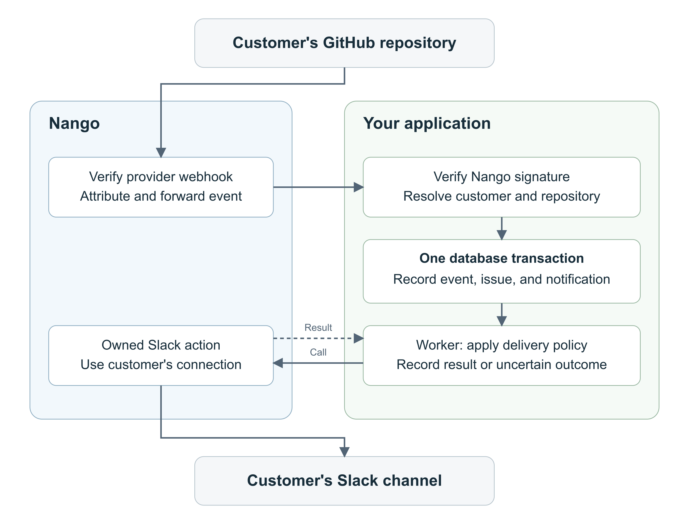

# Migrate a Pipedream workflow to Nango

Author: Emmanuel Oyibo.

This demo rebuilds a GitHub-to-Slack workflow with Nango. A GitHub issue changes, the backend updates a support record, and a worker sends a notification to the customer's Slack channel. It includes the original Pipedream workflow steps, the Nango implementation, tests, and a local dashboard.

## Try the demo without accounts

Use Node.js 24.10 or newer. From this directory, run:

```bash
npm ci
npm run demo
```

The demo uses simulated GitHub events and Slack responses. No accounts or credentials are needed. It prints the results and saves a report and SQLite database under `data/demo-*/`.

Expected results: a duplicate event is ignored, an unknown connection is quarantined, and an unconfirmed Slack write stays `uncertain` instead of being resent.

To run the tests and compile the Nango action:

```bash
npm test
NANGO_CLI_UPGRADE_MODE=ignore npm run compile
```

See [test coverage and live validation](VALIDATION.md) for what these checks cover.

## How it works



| Component | Responsibility |
| --- | --- |
| [`pipedream/`](pipedream/README.md) | Original workflow steps and setup instructions |
| `src/receiver.mjs` | Verify the webhook signature and resolve the customer route |
| `src/store.mjs` | Store issue state, deduplicate events, and queue notifications |
| `src/worker.mjs` | Claim queued notifications and record delivery outcomes |
| `slack/actions/migration-send-message.ts` | Send a Slack message through Nango |
| `src/checkpoint.mjs` | Import confirmed source state without resending a notification |
| `src/dashboard.mjs` | Display support records and notification status locally |

## Run with GitHub and Slack

Use a test repository with Issues enabled, a Slack channel for test messages, and a Nango dev environment. The example maps one customer's GitHub repository to a Slack connection and channel.

### 1. Connect the accounts

Create Nango integrations named `github-app` and `slack` to match the example.

For GitHub, follow [Nango's GitHub App setup](https://nango.dev/docs/api-integrations/github-app/how-to-register-your-own-github-app-api-app):

- Leave user OAuth during installation unchecked.
- Set Setup URL to `https://api.nango.dev/app-auth/connect` and enable **Redirect on update**.
- Grant **Issues: Read-only** and install the app on your test repository.
- Enter the App ID, private key, and public app link in Nango. Complete authorization through **Connections > Add test connection**.

For Slack, use a Nango-managed OAuth app or [configure your own](https://nango.dev/docs/api-integrations/slack/how-to-register-your-own-slack-api-oauth-app). Add a test connection for the intended workspace, verify the bot has `chat:write`, and invite it to the destination channel.

### 2. Configure the backend

```bash
cp .env.example .env
cp fixtures/routes.synthetic.json routes.local.json
```

Fill in `.env`:

| Variable | Value |
| --- | --- |
| `NANGO_API_KEY` | Dev Environment API key for the backend |
| `NANGO_SECRET_KEY_DEV` | The same API key, used by the CLI |
| `NANGO_WEBHOOK_SIGNING_KEY` | Separate environment webhook signing key |

Replace the sample IDs in `routes.local.json` with your customer, integration, connection, repository, and channel IDs. Find connection IDs in Nango, the Slack channel ID under channel details > **About**, and the numeric GitHub repository `id` through `GET https://api.github.com/repos/<OWNER>/<REPO>`.

```bash
npm run routes -- routes.local.json
```

The route determines which customer and Slack destination may receive an event. Keep `.env` and `routes.local.json` untracked. For a product, create these mappings through authenticated enrollment.

### 3. Deploy the Slack action

```bash
NANGO_CLI_UPGRADE_MODE=ignore npm run compile
NANGO_CLI_UPGRADE_MODE=ignore npx nango deploy dev --integration slack --action migration-send-message --no-dependency-update
```

These commands preserve the pinned CLI and dependency versions. Keep `index.ts`, `slack/`, and `.nango/` together. If your Slack integration has a different ID, rename the `slack/` folder and update its imports in `index.ts` and `test/action.test.mjs` before compiling.

### 4. Forward GitHub events

Start the receiver:

```bash
npm start
```

Tunnel `http://127.0.0.1:3407` to HTTPS. In the GitHub connection's **Settings** tab, set **Override webhook URL** to `https://<your-tunnel>/webhooks/nango`. This replaces both environment webhook destinations for that connection.

Enable external webhook forwarding on the Nango GitHub integration. Copy its provider webhook URL and secret into the GitHub App, activate **Issues** events, and keep SSL verification enabled. Leave Nango's **Allow unverified webhooks** off.

### 5. Start the worker and create events

In a second terminal, run:

```bash
npm run worker
```

In a third terminal, start the dashboard:

```bash
npm run dashboard
```

Open `http://127.0.0.1:3408`, then open, close, and reopen an issue in your test repository. Each event should update the support record and send a Slack notification. Redeliver an event from GitHub to check that it does not send another message.

Use `npm run inspect` to print database state. For debugging, stop the continuous worker and use `npm run worker -- --once` to process one ready notification. Keep the dashboard local.

## Delivery behavior

The backend records each accepted event, updates the issue, and queues its notification in one transaction. A worker then sends the message and stores the result.

| Situation | Outcome |
| --- | --- |
| Repeated delivery ID and snapshot | No new notification |
| Same delivery ID with different content | Quarantine |
| Older, unseen event | Preserve newer issue state; notify from the event's snapshot |
| Conflicting snapshots with equal timestamps | Flag for reconciliation |
| Confirmed Slack success | `sent`, with channel and message timestamp |
| Slack HTTP 429 with valid Retry-After | Retry after the delay, up to five total attempts |
| Known auth or permission rejection | `rejected`, retained for recovery |
| Timeout, unknown error, or expired worker lease | `uncertain`, no automatic resend |

For an uncertain write, check Nango logs and Slack history before retrying: the message may already have arrived. The action disables request retries, and the worker retries only explicit Slack rate-limit outcomes. An unclassified Nango SDK error remains uncertain.

## Import confirmed source state and cut over

Pause the old trigger, drain its executions, and stop the destination worker. Reconcile pending, in-flight, or uncertain writes before importing state.

For a source event whose Slack message is confirmed, prepare `data/checkpoint.json` using your actual values:

```json
{
  "deliveryId": "source-github-delivery-id",
  "action": "closed",
  "issueId": "987654",
  "number": 42,
  "title": "Example support issue",
  "state": "closed",
  "updatedAt": "2026-11-01T10:00:00Z",
  "receipt": { "channel": "C123EXAMPLE", "ts": "1234567890.123456" }
}
```

Verify the receipt in Slack, then import it with a route file containing exactly one customer route:

```bash
node --env-file=.env scripts/import-checkpoint.mjs routes.local.json data/checkpoint.json
```

The importer saves the issue snapshot, delivery record, and confirmed receipt without making a provider call. It rejects duplicate delivery IDs, older or conflicting snapshots, mismatched destinations, and unreconciled outbox work.

When switching traffic:

1. Record the switch start time and keep only one notification writer active. Separate GitHub subscriptions can assign different delivery IDs to the same change.
2. Enable the new route and worker. Reconcile changes across the paused interval, using an overlapping time window.
3. Update historical records without sending notifications again. Compare receipts before sending a missing notification.

The importer handles one confirmed event at a time. Add a reconciliation/backfill job for a full migration; current issue snapshots cannot reconstruct every intermediate transition.

To roll back, stop and drain the new writer, reconcile state in the old system, then restart the old trigger. After testing, disable demo triggers/forwarding and stop the worker and tunnel.

## Customize the integration

Edit `slack/actions/migration-send-message.ts` to change the provider operation. Preserve its `sent`, `rejected`, `rate_limited`, and `uncertain` result contract unless you also update the worker.

To start from Nango's catalog instead, use a separate functions project:

```bash
npx skills add NangoHQ/skills -s building-nango-functions-locally
npx nango pull slack send-message --catalog
```

Follow the [coding-agent setup](https://nango.dev/docs/getting-started/coding-agent-setup) to work with Claude Code, Cursor, or Codex. Review the template's inputs, outputs, and retry behavior before adapting it for this backend.

## Adapting this example for production

The demo uses SQLite on one machine and manually configured customer routes. Add your application's enrollment, hosting, monitoring, retention, and recovery processes before serving customers. The example does not provide exactly-once external writes or automatic backfill.

Keep provider verification enabled and monitor exhausted forwarding retries. If you change GitHub App credentials in Nango, update GitHub's webhook secret too. The receiver accepts one Nango signing key; adapt it to accept both keys during a signing-key rotation.

See [Nango functions](https://nango.dev/docs/guides/functions/functions-guide), [webhook verification](https://nango.dev/docs/guides/platform/webhooks-from-nango), and [webhook forwarding](https://nango.dev/docs/guides/platform/webhook-forwarding).
